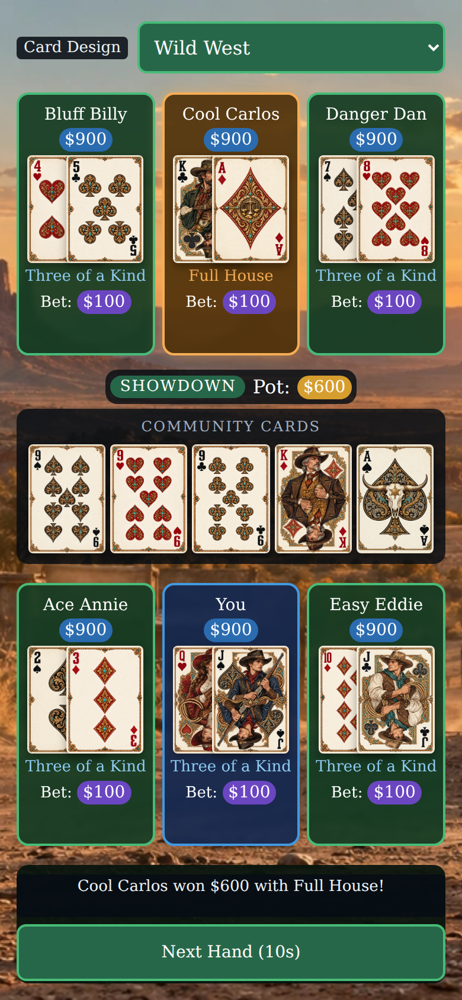

# Portrait phone layout

Enabled by `(max-width:700px) and (orientation:portrait)`. Landscape phones and larger desktop/tablet viewports retain the original 1200×700 layout.

| Row | Left | Center | Right |
| --- | --- | --- | --- |
| Upper opponents | Seat 2 | Seat 3 | Seat 4 |
| Lower players | Seat 1 | You (seat 0) | Seat 5 |

Action still follows `0 → 1 → 2 → 3 → 4 → 5 → 0`, clockwise around the community cards. CSS changes positions only; no player IDs or game rules change.

- All hole cards and community cards share one responsive width and preserve their theme's aspect ratio. At a 390 px viewport they are approximately 65 px wide.
- The right hole card covers the right half of the left card. Community cards remain separate and in one row.
- Each player panel reserves room below the cards for hand strength and the bet. Opponent cards and hand strength are revealed at the same game stages as before. Long labels or additional all-in status can expand the panel.
- The theme selector is at the top; game actions are at the bottom. Short screens can scroll to reach every player, while actions remain available.
- Rotation is entirely a layout change. It does not rerender the cards, restart theme music, reset the hand, or restart timers.

## Screenshot

Wild West at a 390×844 CSS-pixel viewport (2× pixel density). This staged showdown demonstrates all six players' two status lines and overlapping cards; no demonstration state is included in the game itself.

## Verification

- Chromium phone emulation at 320×568, 360×640, 390×844, 430×932, 600×900, and 700×1000 with both the taller SVG-cards deck and Wild West.
- All nine themes checked at 390×844: cards loaded, sizes matched, overlap was exactly half a card, opponents stayed hidden before showdown, and seats remained clockwise.
- Showdown with every player's hand strength and bet; additional all-in/folded/thinking states; scrolling on a short viewport to expose the lower players above the controls.
- Geometry compared to the previous main branch at 1200×700, 1920×1080, 1440×1080, 844×390, and 768×1024: canvas, seats, cards, community area, menu, and controls matched.
- Rotation preserved the same game object, card elements, active music source, and next-hand countdown timer. A real Deal Cards button click still dealt to all six players.
- All eight existing theme-music tests passed; no browser page errors.

These checks use Chromium emulation, not a physical phone.
